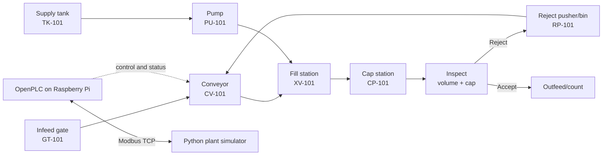
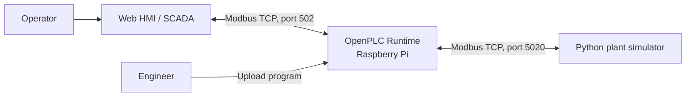
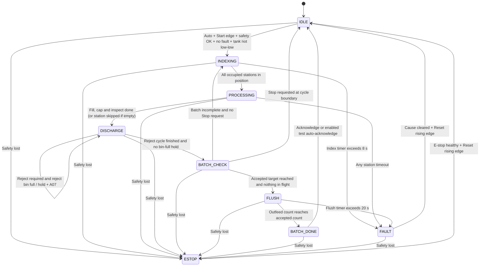

# Specification: Automated Bottling Line

| Field | Value |
|---|---|
| Version | 0.1 (draft) |
| Date | 2026-10-18 |
| Author | [Your Name] |
| Status | Draft |

> **Document boundary:** This specification follows the Week 2 guide and the project plan. Week 1 established the Raspberry Pi/OpenPLC environment and a minimal Python Modbus TCP round trip. This document records the intended bottling-line specification; it does not claim that the complete multi-station process, HMI, safety logic, or PID controller has already been implemented or tested.

## 1. Introduction: purpose, scope, assumptions, glossary

### Purpose

The control system shall automatically fill, cap, inspect and count bottles on a single line, producing batches of a set size, and shall stop safely on any fault.

### Scope

**In scope**

- PLC logic in Ladder Diagram (LD) and Structured Text (ST) running on OpenPLC Runtime on a Raspberry Pi.
- A simulated single-line bottling process with five process stations, a supply tank and a pump.
- A Python plant simulator connected to OpenPLC through Modbus TCP.
- Specification of operating modes, sequence behaviour, counters, interlocks, alarms, process-control parameters and I/O mapping.
- A web HMI specification for operator commands, status, alarms and trends.
- A documented test campaign with recorded evidence.

**Out of scope**

- Real hardware wiring, electrical-panel design and physical drive integration.
- Palletising, labelling and multiple production lines.
- Cloud, MES or ERP integration (stretch goals only).
- Certified functional safety or SIL/PL-rated safety functions.
- Real production data or guaranteed production throughput.

The E-stop described here is a **simulation learning model implemented in ordinary PLC logic**. A real machine must use appropriately designed, hard-wired or safety-rated emergency-stop equipment; the emergency-stop function must not depend solely on ordinary PLC software. This project does not claim functional-safety certification.

### Assumptions

1. The simulated product uses one bottle size.
2. The Python simulator behaves as an ideal Modbus TCP server for initial control exercises.
3. Network latency below 50 ms is a design assumption to validate; it is not a measured result from this specification.
4. The operator is trained to use the HMI commands, states and alarm indications.
5. The supply tank is replenished from an effectively infinite source in the simulator.
6. The default batch target is 24 accepted bottles; the configured HMI range is 1–99.
7. The PLC is the only location where control logic runs. The simulator models the plant and exposes its signals over Modbus TCP.
8. The current Week 1 demonstration map is a minimal test map. The full signal map in Section 8 is the intended Week 2 specification and requires the corresponding simulator integration work before it can be treated as a running implementation.
9. The initial slave-device polling period is 100 ms. The project plan targets a 50 ms PLC task; reducing the polling period to 50 ms is planned for a later project stage.

### Glossary

| Term | Definition |
|---|---|
| PLC | Programmable Logic Controller; executes control logic from input data and updates outputs. |
| HMI | Human–Machine Interface; the operator-facing display for commands, system state, alarms and trends. |
| FAT | Factory Acceptance Test; a structured test campaign that checks a system against its specification. Here, the plant is simulated. |
| Scan cycle | The recurring PLC execution interval in which program logic is run. |
| Interlock | A condition that must be satisfied before an operation or actuator is permitted. |
| Latched | A state that remains active after its triggering condition clears until a defined clearing command is accepted. |
| Fail-safe | A design principle that moves equipment to a defined safe state when a fault occurs. The simulated standard-PLC E-stop here is not a certified safety function. |
| Modbus TCP | The TCP/IP-based communication protocol used between OpenPLC and the Python plant simulator, and specified for the HMI interface. |

## 2. Process description and equipment list (tags, process sketch)

### Process description

The plant represents one conveyor line with an infeed gate, filling, capping, inspection, reject handling and outfeed. A supply tank feeds the fill valve through a variable-speed pump. The conveyor indexes bottles between station positions and stops while the stations perform their operations.

1. The infeed gate releases empty bottles one at a time.
2. The conveyor indexes bottles until the occupied stations are in position, then stops.
3. At the fill station, the fill valve opens for a time calculated from the target volume and estimated flow at the current tank level.
4. At the cap station, the capper cycles. At inspection, measured fill volume is checked against tolerance and cap presence is checked.
5. A bottle that fails either quality check is diverted by the reject pusher. Accepted bottles continue to the outfeed and count toward the batch.
6. A tank-level controller adjusts pump speed to maintain the tank setpoint.

### Process sketch

The editable/viewable drawing is intended to live at [diagrams/process-sketch.drawio](diagrams/process-sketch.drawio) and [diagrams/process-sketch.png](diagrams/process-sketch.png). The embedded Mermaid sketch above provides a readable process overview until those drawing files are added.

### System context

OpenPLC acts as the Modbus TCP master/client for the simulator; the simulator is the Modbus TCP server. The HMI is specified to use a separate address block exposed by the OpenPLC Modbus server. Keep the HMI address block separate from simulator-mapped I/O.

### Equipment and tag list

| Tag | Equipment | Related signals / purpose |
|---|---|---|
| CV-101 | Conveyor with single drive | `Q_ConveyorRun`, `I_ConvOL_OK`, `I_ConvRunning` |
| GT-101 | Infeed gate | `Q_InfeedGate`, `I_InfeedPresent` |
| TK-101 | Supply tank | `I_TankLevel_raw`, `I_TankLow_LS`, `I_TankHigh_LS` |
| PU-101 | Variable-speed supply pump | `Q_PumpSpeed_raw` |
| XV-101 | Fill valve | `Q_FillValve` |
| CP-101 | Capper head | `Q_CapperRun` |
| RP-101 | Reject pusher and reject bin | `Q_RejectPusher`, `I_RejectBinFull` |
| ZS-101 to ZS-104 | Position sensors at fill, cap, inspect and outfeed | `I_FillPos`, `I_CapPos`, `I_InspectPos`, `I_OutfeedSensor` |
| QT-101, QT-102 | Fill-volume measurement and cap-presence sensor | `I_FillVolume_x10`, `I_CapPresent` |
| HS-101 | Simulated E-stop chain | `I_EStop_OK` |
| SL-101 | Green/amber/red stack light | `Q_BeaconGreen`, `Q_BeaconAmber`, `Q_BeaconRed` |

## 3. Operating modes and command behaviour

### Operating modes and fault classes

| Mode / class | Required behaviour |
|---|---|
| Manual | Operator may jog the conveyor, fill valve, capper and reject pusher through the HMI. All safety conditions and interlocks remain active. |
| Auto | The master state machine runs the automatic index, process and discharge cycle after a valid Start command. At batch completion, the line waits for acknowledgement. |
| E-stop | Highest priority. De-energise all actuator outputs, latch the E-stop state and require the E-stop signal to be healthy plus a Reset rising edge before leaving the state. |
| Fault (stop) | A stop-class fault, such as overload, jam/timeout, communication loss, tank low-low or missing run feedback, stops the line and latches the fault until the cause is cleared and Reset is pressed. |
| Warning (continue) | A warning, such as consecutive rejects or high tank level, is annunciated but does not necessarily stop the line. Reject-bin full holds the sequence at DISCHARGE when a reject is required. |

### Command matrix

| Command | Manual mode | Auto mode | Fault or E-stop |
|---|---|---|---|
| Start | Ignored | Starts a cycle if IDLE; ignored if already running | Ignored |
| Stop | Turns all jogs off | Requests a controlled stop at the end of the current cycle | Ignored; the fault/E-stop response takes priority |
| Reset | Ignored | Ignored unless the controller is handling a latched fault/E-stop | Clears the latch only when the cause is gone and a rising edge is received |
| Acknowledge | Acknowledges warnings | Acknowledges warnings and exits BATCH DONE | Acknowledges the display only; it does not reset the fault |
| Jog commands | Permitted only when the relevant interlocks are satisfied | Ignored | Ignored |
| Mode change | Permitted when stopped | Forces the line to a stopped IDLE condition before changing mode | Ignored until reset/recovery conditions are satisfied |
| Auto-acknowledge batch | Not used for normal manual operation | Optional engineering/test command for unattended endurance testing | Must not reset a fault or E-stop |

Start, Reset and Acknowledge are pulse/edge commands, not commands that should repeatedly act while a button is held. The HMI shall write momentary command bits and return them to zero; the PLC shall detect their rising edges.

## 4. Sequence: master state machine, FB_Station, counters, output matrix

### Master state machine

The proposed state numbers are fixed as follows:

| State number | State | Purpose |
|---:|---|---|
| 0 | IDLE | Outputs are stopped except the defined tank-control behaviour; await a valid Auto Start. |
| 10 | INDEXING | Release a permitted bottle and run the conveyor until occupied stations reach position. |
| 20 | PROCESSING | Run the fill, cap and inspection station actions. |
| 30 | DISCHARGE | Complete the reject action if needed; hold here if the reject bin is full. |
| 40 | BATCH_CHECK | Update and compare counters, and decide whether to index again, stop, or flush. |
| 45 | FLUSH | Close the infeed gate and index remaining accepted bottles to the outfeed. |
| 50 | BATCH_DONE | Batch target is met and accepted bottles have cleared the line; wait for acknowledgement. |
| 90 | FAULT | Stop the line and hold the fault until the cause is cleared and Reset is received. |
| 99 | ESTOP | Highest-priority state; actuator outputs are off until E-stop healthy and Reset edge. |

A safety loss takes priority over ordinary state transitions. Any active stop-class fault sends the sequence to FAULT unless E-stop has priority. The initial state at PLC start-up is IDLE with outputs off; the controller must not automatically restart a cycle after a runtime restart.

### Transition guards

| Transition | Guard | Action |
|---|---|---|
| IDLE → INDEXING | Auto mode AND Start rising edge AND safety OK AND no latched fault AND tank not low-low | Clear cycle flags and start index timer |
| INDEXING → PROCESSING | Every occupied station's position sensor is true | Stop conveyor and arm the station actions |
| INDEXING → FAULT | Index timer exceeds 8 s | Record fault code 3 |
| PROCESSING → DISCHARGE | Fill, cap and inspect report Done, or an empty station is skipped | Latch inspection result |
| PROCESSING → FAULT | Any station timeout | Record fault code 4 |
| DISCHARGE → BATCH_CHECK | Reject action finished if required, and no reject-bin-full hold | Update counters |
| DISCHARGE remains active | Reject required AND reject bin full | Hold sequence and raise A07 until bin is emptied and acknowledged |
| BATCH_CHECK → INDEXING | Batch not complete and no Stop request | Begin next cycle |
| BATCH_CHECK → FLUSH | Accepted count reaches target and no bottles are in flight | Close infeed gate |
| BATCH_CHECK → IDLE | Stop request | Controlled stop at the end of the cycle |
| FLUSH → BATCH_DONE | Outfeed count is at least the accepted count | Stop conveyor and reset flush timer |
| BATCH_DONE → IDLE | Acknowledge, or auto-acknowledge is enabled for test mode | Reset batch counters |
| Any state → ESTOP | Safety signal is lost | Turn all outputs off immediately |
| Any non-ESTOP state → FAULT | A stop-class fault becomes active | Record fault code and command the defined safe state |
| FAULT → IDLE | Cause cleared AND Reset rising edge | Clear latched fault |
| ESTOP → IDLE | E-stop healthy AND Reset rising edge | Clear E-stop latch |

### Reusable FB_Station interface

Fill, cap and inspect use the same station pattern.

| Pin | Direction | Type | Meaning |
|---|---|---|---|
| `Enable` | Input | BOOL | Master sequence arms the station for the current cycle |
| `Occupied` | Input | BOOL | A bottle is in position at the station |
| `DoneCond` | Input | BOOL | Station-specific completion condition, such as timer elapsed or measurement taken |
| `TimeoutPT` | Input | TIME | Maximum time permitted before a timeout |
| `Active` | Output | BOOL | Station is working and may drive its actuator |
| `Done` | Output | BOOL | Station is finished; TRUE immediately if the station is empty |
| `Timeout` | Output | BOOL | Timeout elapsed before `DoneCond`; latched until `Enable` falls |

### Counters and batch rules

| Counter | Increment event | Purpose |
|---|---|---|
| Released | Infeed gate releases a bottle | Tracks bottles released into the process |
| Accepted | Inspection accepts a bottle | Compared against the batch target |
| Rejected | Reject pusher removes a bottle | Reject total and consecutive-reject alarm |
| Outfeed | Outfeed sensor rising edge | Production count, jam cross-check and end-of-FLUSH check |

- **In flight** = `Released - Accepted - Rejected`; it represents bottles between release and inspection decision.
- Release a bottle only when `Accepted + In flight` is below the batch target. Rejected bottles can therefore be replaced without overshooting the requested accepted quantity.
- When Accepted reaches the target and In flight is zero, enter FLUSH. Keep the infeed gate closed and index until `Outfeed >= Accepted`, then enter BATCH DONE.
- The Acknowledge command ends BATCH DONE. Auto-acknowledge is an optional engineering/test input for endurance runs, not a fault-reset mechanism.

### Output matrix

`0` means off. `flash` means a 1 Hz cycle (0.5 s on, 0.5 s off). `warn` means steady amber while any warning is active.

| Output | IDLE | INDEX | PROC | DISCH | FLUSH | BATCH DONE | FAULT | ESTOP |
|---|---|---|---|---|---|---|---|---|
| `Q_ConveyorRun` | 0 | 1 until position | 0 | 0 | 1 until flush condition | 0 | 0 | 0 |
| `Q_InfeedGate` | 0 | 0.5 s pulse if release allowed | 0 | 0 | 0 | 0 | 0 | 0 |
| `Q_FillValve` | 0 | 0 | Active fill action | 0 | 0 | 0 | 0 | 0 |
| `Q_CapperRun` | 0 | 0 | Active cap action | 0 | 0 | 0 | 0 | 0 |
| `Q_RejectPusher` | 0 | 0 | 0 | On if rejecting | 0 | 0 | 0 | 0 |
| `Q_BeaconGreen` | Flash | 1 | 1 | 1 | 1 | 0 | 0 | 0 |
| `Q_BeaconAmber` | Warn | Warn | Warn | Warn | Warn | Flash | 0 | 0 |
| `Q_BeaconRed` | 0 | 0 | 0 | 0 | 0 | 0 | 1 | Flash |
| `Q_PumpSpeed_raw` | PID | PID | PID | PID | PID | PID | PID unless tank is above high-high | 0 |

Only one program/arbitration point shall ultimately write each actuator output. Exact program organisation and implementation are planned work; the table specifies required behaviour, not completed code.

## 5. Safety and interlocks

### Safety behaviour

- `I_EStop_OK` is a fail-safe signal: `1 = healthy`; `0` or loss of signal means E-stop/trip.
- The E-stop trip latches. It clears only when the input is healthy and a Reset rising edge is received.
- On PLC start-up, outputs default off and state is IDLE. There is no automatic restart after a power or runtime restart.
- E-stop has priority over all other states and faults. In ESTOP, all actuator outputs, including the pump command, are off.
- Conveyor overload, jam/station timeout, communication loss, tank low-low and lost conveyor run feedback are stop-class faults. They latch and require the cause to clear plus a Reset edge.
- Acknowledge and Reset are distinct. Acknowledge clears/recognises warnings or the batch-done indication; it does not restart the machine or clear a latched safety fault.
- Safety-related signals use the same polarity convention throughout: healthy state is `1`.

### Actuator interlocks

- The fill valve may open only when `I_FillPos` is true, the conveyor is stopped, safety is healthy and tank low-low is not active.
- The reject pusher must not operate while the conveyor is running.
- Manual jogs are ignored in Auto mode and whenever their interlocks are not satisfied.
- Auto Start is ignored in Manual mode, while the line is running, or while a fault is latched.
- A mode change forces the line to a stopped IDLE condition before the new mode is applied.
- Tank low-low inhibits filling and stops the line according to A05.
- Tank high-high forces the pump output to zero.
- Stop is a controlled stop at the current cycle boundary; E-stop is immediate.

The E-stop in this project is a learning simulation only. A real machine requires a properly assessed and safety-rated emergency-stop design independent of standard PLC logic.

## 6. Process control: fill compensation, tank PID

### Fill-time compensation

The target fill volume is **330 ml**, with an acceptance tolerance of **±5 ml**. Fill time is computed from the target volume and estimated flow using the tank level:

`estimated flow (ml/s) = 131.5 × sqrt(tank level fraction)`

`fill time (s) = target volume (ml) / estimated flow (ml/s)`

The computed time is clamped to a maximum of **5.0 s**. At a tank level of 70%, the estimated flow is approximately 110 ml/s and the nominal fill time is 3.0 s. Compensation is intended to tolerate tank-level changes down to about 25%; at 20% tank level the capped fill time is expected to underfill and the inspection logic should reject the bottle.

Inspection shall reject a bottle when the measured volume is outside 330 ml ±5 ml **or** when cap presence is false. The fill sensor's engineering range is 0–500.0 ml, represented as raw input register values 0–5000 in tenths of a millilitre.

### Supply tank and pump control

- Tank capacity: 20 L.
- Initial tank-level setpoint: 70% (14 L).
- Maximum simulated pump inflow: 0.20 L/s at 100% pump command.
- Level control: PI/PID function holding tank level around the setpoint by adjusting pump speed.
- Starting PI values: `Kp = 1.5`, `Ti = 20 s`, output clamp 0–100%, direct acting. These are starting estimates for later tuning, not validated tuning results.
- The controller should include output clamping and anti-windup, and support manual/automatic control.
- The pump controller runs in every master state except ESTOP, and the pump output is forced to zero above the high-high tank limit.
- Level scaling: raw 0–32767 represents 0–100%. Sensor-noise assumptions are fill volume ±1 ml and tank level ±0.2 percentage points.

Detailed parameter values, units and calculation tables are maintained in [parameters.md](parameters.md).

## 7. Alarms and fault codes

The complete alarm philosophy, alarm table, fault codes and `FB_Alarm` interface are maintained in [alarms.md](alarms.md).

| ID | Alarm | Activation condition | Delay | Class / priority | Required action and clear condition |
|---|---|---|---:|---|---|
| A01 | E-stop tripped | `I_EStop_OK = 0` | 0 s | Fault / P1 | All outputs off; state ESTOP (99). Clear only when healthy and Reset received. |
| A02 | Conveyor overload | `I_ConvOL_OK = 0` | 0 s | Fault / P1 | Stop line; fault code 2. Clear after overload condition is removed and Reset received. |
| A03 | Jam or timeout | Index >8 s, station timeout, or FLUSH >20 s | Timer | Fault / P2 | Stop line; code 3 for index/flush timeout or code 4 for station timeout. Clear cause and Reset. |
| A04 | Communication lost | Heartbeat unchanged for 2 s | 2 s | Fault / P1 | Outputs off; fault code 5. Clear after heartbeat returns and Reset is received. |
| A05 | Tank low-low | Tank level below 10% | 0.5 s | Fault / P2 | Inhibit fill and stop line; code 6. Clear when level is above 20% and Reset is received. |
| A06 | Consecutive rejects | 3 rejects in a row | None | Warning / P3 | Annunciate and continue running. Clear by Acknowledge. |
| A07 | Reject bin full | `I_RejectBinFull = 1` | 0.5 s | Warning / P2 | Hold in DISCHARGE if a reject is required. Clear after bin is emptied and acknowledged. |
| A08 | Tank high-high | Tank level above 95% | 0.5 s | Warning / P2 | Set pump speed to zero. Self-clear when level falls below 90%. |
| A09 | Run feedback lost | `Q_ConveyorRun = 1` and `I_ConvRunning = 0` | 2 s | Fault / P2 | Stop line; fault code 7. Clear cause and Reset. |

### Fault-code and alarm-word mapping

| Fault code | Meaning | Alarm | `ST_AlarmWord` bit |
|---:|---|---|---:|
| 1 | E-stop | A01 | 0 |
| 2 | Conveyor overload | A02 | 1 |
| 3 | Index or FLUSH timeout | A03 | 2 |
| 4 | Station timeout | A03 | 2 |
| 5 | Communication lost | A04 | 3 |
| 6 | Tank low-low | A05 | 4 |
| — | Consecutive rejects | A06 | 5 |
| — | Reject bin full | A07 | 6 |
| — | Tank high-high | A08 | 7 |
| 7 | Run feedback lost | A09 | 8 |

Bits 9–15 of `ST_AlarmWord` are reserved. The HMI decodes bits 0–8 to display the active alarm IDs and messages. Alarm implementation and test evidence are separate deliverables; their source-of-truth documents are linked above and in Section 10.

## 8. I/O list and Modbus map

The full Week 2 simulator-side map is specified in [io-list.csv](io-list.csv); the separate HMI address block is specified in [io-list-hmi.csv](io-list-hmi.csv). These CSV files are intended to be the authoritative signal lists, with one signal per row and addresses, types, ranges, polarity and descriptions recorded there.

### Modbus arrangement

- OpenPLC is the Modbus TCP master/client for the simulator.
- Python simulator: Modbus TCP server on port **5020**.
- OpenPLC's own Modbus TCP server for HMI data: port **502**.
- Simulator-side sensor signals use discrete inputs (DI) or input registers (IR); actuator signals use coils (COIL) or holding registers written by the PLC (HR).
- Modbus addresses are zero-based. The HMI commands and status must use separate address ranges and must not collide with simulator-mapped I/O.

### Simulator-side address summary

| Signal group | Modbus object / address range | OpenPLC mapping | Notes |
|---|---|---|---|
| Discrete inputs | DI 0–12 | `%IX100.0` through `%IX101.4` | Week 2 target map adds `I_ConvRunning` at DI 12 / `%IX101.4`; the slave-device size must cover 13 inputs when the updated simulator is available. |
| Digital outputs | COIL 0–7 | `%QX100.0` through `%QX100.7` | Conveyor, valve, capper, reject pusher, infeed gate and beacons. |
| Analog inputs | IR 0–1 | `%IW100`–`%IW101` | Tank level and fill-volume measurement. |
| Analog output | HR 0 | `%QW100` | Pump speed command. |

### Principal simulator signals

| Tag | Modbus object/address | OpenPLC location | Meaning |
|---|---|---|---|
| `I_EStop_OK` | DI 0 | `%IX100.0` | E-stop chain healthy (`1 = healthy`) |
| `I_InfeedPresent` | DI 1 | `%IX100.1` | Bottle waiting at infeed gate |
| `I_FillPos` | DI 2 | `%IX100.2` | Bottle at fill station |
| `I_CapPos` | DI 3 | `%IX100.3` | Bottle at cap station |
| `I_InspectPos` | DI 4 | `%IX100.4` | Bottle at inspection |
| `I_CapPresent` | DI 5 | `%IX100.5` | Cap detected |
| `I_RejectBinFull` | DI 6 | `%IX100.6` | Reject bin full |
| `I_OutfeedSensor` | DI 7 | `%IX100.7` | Outfeed count pulse |
| `I_ConvOL_OK` | DI 8 | `%IX101.0` | Conveyor overload healthy (`1 = healthy`) |
| `I_TankLow_LS` | DI 9 | `%IX101.1` | Tank above low switch |
| `I_TankHigh_LS` | DI 10 | `%IX101.2` | Tank high switch reached |
| `I_Heartbeat` | DI 11 | `%IX101.3` | Heartbeat toggles every 500 ms |
| `I_ConvRunning` | DI 12 | `%IX101.4` | Conveyor run feedback (`1 = moving`) |
| `Q_ConveyorRun` | COIL 0 | `%QX100.0` | Conveyor drive command |
| `Q_FillValve` | COIL 1 | `%QX100.1` | Fill valve command |
| `Q_CapperRun` | COIL 2 | `%QX100.2` | Capper cycle command |
| `Q_RejectPusher` | COIL 3 | `%QX100.3` | Reject pusher command |
| `Q_InfeedGate` | COIL 4 | `%QX100.4` | Infeed gate command |
| `Q_BeaconGreen` | COIL 5 | `%QX100.5` | Green stack light |
| `Q_BeaconAmber` | COIL 6 | `%QX100.6` | Amber stack light |
| `Q_BeaconRed` | COIL 7 | `%QX100.7` | Red stack light |
| `I_TankLevel_raw` | IR 0 | `%IW100` | 0–32767 represents 0–100% tank level |
| `I_FillVolume_x10` | IR 1 | `%IW101` | 0–5000 represents 0–500.0 ml |
| `Q_PumpSpeed_raw` | HR 0 | `%QW100` | 0–32767 represents 0–100% pump speed |

### HMI address-block summary

The HMI address block is separate from simulator-side I/O. See [io-list-hmi.csv](io-list-hmi.csv) for the complete row-by-row map.

| Signal(s) | Modbus address | OpenPLC location | Direction / use |
|---|---|---|---|
| `HMI_Start`, `HMI_Stop`, `HMI_Reset` | COIL 8–10 | `%QX101.0`–`%QX101.2` | HMI to PLC; momentary commands |
| `HMI_AutoSel` | COIL 11 | `%QX101.3` | HMI to PLC; 1 = Auto, 0 = Manual |
| `HMI_ManConv`, `HMI_ManFill`, `HMI_ManCap`, `HMI_ManReject` | COIL 12–15 | `%QX101.4`–`%QX101.7` | HMI to PLC; manual jog commands |
| `ST_Running`, `ST_Fault`, `ST_EStop` | COIL 16–18 | `%QX102.0`–`%QX102.2` | PLC to HMI; status indicators |
| `HMI_Ack`, `HMI_AutoAckBatch` | COIL 24–25 | `%QX103.0`–`%QX103.1` | HMI to PLC; acknowledge and test-mode batch acknowledgement |
| `HMI_BatchTarget` | HR 10 | `%QW110` | HMI to PLC; batch target, default 24 |
| `HMI_LevelSP_x10` | HR 11 | `%QW111` | HMI to PLC; tank setpoint in 0.1% units |
| `ST_State` | HR 20 | `%QW120` | PLC to HMI; master state number |
| `ST_GoodCount`, `ST_RejectCount`, `ST_BatchCount` | HR 21–23 | `%QW121`–`%QW123` | PLC to HMI; counters |
| `ST_TankLevel_x10` | HR 24 | `%QW124` | PLC to HMI; tank level in 0.1% units |
| `ST_AlarmWord` | HR 25 | `%QW125` | PLC to HMI; alarm bit word |
| `ST_LastFill_x10` | HR 26 | `%QW126` | PLC to HMI; last fill volume in 0.1 ml units |

**Week 1 compatibility note:** Week 1 used a deliberately smaller demonstration map (`I_Button` at DI 0, `I_Heartbeat` at DI 11, `I_TankLevel_raw` at IR 0, `Q_Lamp` at COIL 0 and `Q_PumpSpeed_raw` at HR 0). The full Week 2 map assigns DI 0 to `I_EStop_OK` and defines the bottling-line signals above. Do not assume the full map is already running in the Week 1 simulator; map expansion and verification are part of the subsequent simulator integration work.

## 9. HMI requirements

The intended HMI is a web-based operator screen. Its detailed wireframe, control descriptions and display elements are maintained in [hmi-spec.md](hmi-spec.md).

The HMI specification shall cover:

- Current mode and state name/number, plus a visible alarm banner and alarm list.
- A line mimic showing infeed, fill, cap, inspection, reject and outfeed.
- Tank level gauge and a five-minute level trend; setpoint display and entry.
- Good, rejected and batch counters, plus last measured fill volume.
- Start, Stop, Reset and Acknowledge momentary commands.
- Auto/Manual mode selection and manual jog buttons visible only in Manual mode.
- Batch target entry and optional engineering-only auto-acknowledge for endurance testing.
- Running, Fault and E-stop status lamps.

HMI-entered values must also be validated in PLC logic. Clamp batch target to **1–99** and tank-level setpoint to **50–90%** regardless of what value the HMI client sends. HMI limits alone are not protection. The HMI is a specified future work item; its existence and operation must be verified by the requirements/test documents before being reported as complete.

## 10. Requirements and traceability

Stable, individually testable requirements are maintained in [requirements.md](requirements.md), with the corresponding test procedures and evidence fields in [test-plan.md](test-plan.md).

The Week 2 traceability set includes the following requirement groups:

- **Safety (R-S):** E-stop response, latching/reset, power-up in a safe state, communication-loss response, overload response and fill-valve interlock.
- **Operation (R-O):** Auto sequence, manual jog interlocks, mode changes, batch completion, jam/station timeout and run-feedback timeout.
- **Quality (R-Q):** Fill-volume rejection, missing-cap rejection, reject-bin-full handling and consecutive-reject warning.
- **Process control (R-P):** Fill-time compensation, tank-level regulation, setpoint response, low-low fill inhibit and high-high pump stop.
- **System (R-X):** I/O map consistency, scan-cycle stability, HMI functionality and endurance.

The test plan is expected to cover T01–T18. It includes I/O verification, normal Auto operation, manual interlocks, E-stop, overload, underfill, missing cap, bin-full handling, jam/timeout, tank low-low, PID step response, batch completion, restart behaviour, communication loss, endurance, tank high-high (T17) and lost run feedback (T18). Every requirement must trace to at least one test; every test must verify at least one requirement; and every alarm must appear in at least one test.

Tests and evidence are planned records until actually run. Do not label a requirement as passed without recording the observed result and evidence reference.

## 11. Parameters

The parameter source of truth is [parameters.md](parameters.md). It shall include units, rationale and the fill-compensation and tank-balance sanity-check tables.

| Parameter | Initial specified value |
|---|---|
| Target fill volume | 330 ml |
| Fill acceptance tolerance | ±5 ml |
| Batch target | Default 24 accepted bottles; HMI range 1–99 |
| Conveyor index, one pitch | 2.0 s |
| Infeed gate pulse | 0.5 s |
| Fill time at 70% tank level | 3.0 s |
| Maximum compensated fill time | 5.0 s |
| Cap cycle / inspection time | 2.0 s / 1.0 s |
| Reject pusher extension | 0.6 s |
| Nominal cycle time per bottle | 5.6 s (2.0 + 3.0 + 0.6 s) |
| Index timeout / FLUSH timeout | 8 s / 20 s |
| Station timeouts: fill / cap / inspect / reject | 6 s / 4 s / 3 s / 2 s |
| Heartbeat timeout | 2.0 s |
| Run-feedback timeout | 2.0 s |
| Alarm on-delay: safety / process | 0 s / 0.5 s |
| Tank capacity | 20 L |
| Tank level setpoint | 70% (14 L) |
| Pump inflow at 100% command | 0.20 L/s |
| Tank thresholds | Low-low 10%; low switch 20%; high switch 90%; high-high 95% |
| Valve flow model | `flow = 131.5 × sqrt(level fraction)` ml/s |
| PI starting values | `Kp = 1.5`, `Ti = 20 s`; output 0–100% |
| Simulated fill-volume noise | ±1 ml |
| Simulated tank-level noise | ±0.2 percentage points |
| PLC scan cycle | 50 ms target |
| Slave-device polling | 100 ms initially; 50 ms planned for a later stage |

These are specification/start-up values, not a claim that timing, fill accuracy, or PID performance has already been validated. If a parameter changes, update every affected document and record the reason in [decisions.md](decisions.md).

## 12. Decision log and change log

The decision record is maintained in [decisions.md](decisions.md). The Week 2 guide's baseline decisions to capture there include:

- **D-01:** Default batch target 24; HMI range 1–99.
- **D-02:** Target volume 330 ml, tolerance ±5 ml.
- **D-03:** Tank capacity 20 L and initial setpoint 70%.
- **D-04:** Beacon convention: green flashes in IDLE and is steady while running; amber indicates warnings and flashes at BATCH DONE; red is steady for FAULT and flashes for ESTOP.
- **D-05:** Tank PID runs in every state except ESTOP, and pump output is zero above high-high level.
- **D-06:** Reject a bottle if fill is outside tolerance or cap is missing.
- **D-07:** Use Released, Accepted, Rejected and Outfeed counters, and add FLUSH state 45 to avoid batch overshoot.
- **D-08:** Reset requires a rising edge and cleared cause; Acknowledge is separate and does not restart the line.
- **D-09:** Ignore Start while a fault is latched.
- **D-10:** Safety alarms have zero delay; process alarms use 0.5 s filtering unless individually specified otherwise.
- **D-11:** Add `I_ConvRunning`, `HMI_Ack`, `HMI_AutoAckBatch`, alarm A09 and tests T17/T18.
- **D-12:** Stop is controlled at the end of the current cycle; E-stop is immediate.

Any post-baseline change shall include an ID, date, reason and affected documents in the decision/change log, and shall trigger a version update. The I/O list's Week 2 v1.1 updates include the run-feedback input, new HMI commands and the expanded discrete-input range.

## Change log

| Version | Date | Change | Reason |
|---|---|---|---|
| 0.1 | 2026-10-18 | Drafted the 12-section specification outline; added process, state, control, safety, alarm, I/O, HMI, requirements and parameter summaries with companion-document links. | Align the repository documentation with the Week 2 guide while retaining Week 1 setup as the implementation baseline. |
